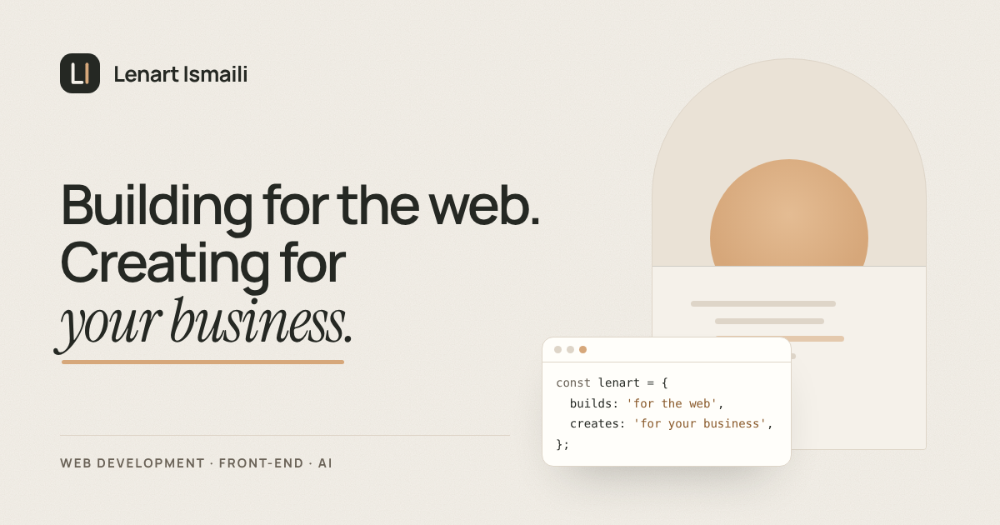

# Lenart Ismaili — Portfolio

The personal portfolio of **Lenart Ismaili**, Web Developer, Front-End Developer and AI Developer.

A warm, editorial single-page site built with React and Vite: ivory and sand tones, confident
typography, and a featured case study of [TwoMindsDev](https://twomindsdev.com/).



- **Live site:** https://webdevlenart.github.io/Lenart/ (once GitHub Pages is enabled, see [Deployment](#deployment))
- **GitHub:** [@webdevLenart](https://github.com/webdevLenart)
- **Instagram:** [@veqlenart](https://www.instagram.com/veqlenart/)

## Features

- Sections for Home, About, Skills, Projects and Contact, with a sticky navigation that highlights
  the section you are reading
- Accessible mobile menu: focus moves into the menu, stays there while it is open, and returns
  to the menu button when you press <kbd>Esc</kbd>
- Project showcase with real screenshots of the live website on desktop and mobile
- Subtle scroll-in animations that switch off when the visitor prefers reduced motion
- Semantic HTML, skip link, visible focus states and touch-friendly controls
- SEO and Open Graph metadata, an “LI” favicon and a social preview image
- No tracking, no external requests at runtime: fonts are self-hosted

## Tech stack

- [React 19](https://react.dev/) and [Vite 8](https://vite.dev/)
- Plain CSS with design tokens (`src/styles/tokens.css`)
- [Lucide](https://lucide.dev/) icons, with GitHub and Instagram marks from [Simple Icons](https://simpleicons.org/)
- [Manrope](https://fonts.google.com/specimen/Manrope), [Inter](https://fonts.google.com/specimen/Inter)
  and [Instrument Serif](https://fonts.google.com/specimen/Instrument+Serif) via Fontsource

## Getting started

Requires [Node.js](https://nodejs.org/) 20.19+ or 22.12+.

```bash
npm install       # install dependencies
npm run dev       # start the development server at http://localhost:5173
npm run build     # create a production build in dist/
npm run preview   # serve the production build locally
```

## Editing the content

All content lives in plain JavaScript files in `src/data/`, so you rarely need to touch the components.

| File | What it controls |
| --- | --- |
| `src/data/site.js` | Name, roles, the businesses the hero headline cycles through, social links, the public site URL and an optional email address |
| `src/data/navigation.js` | Navigation links (each `id` matches a section on the page) |
| `src/data/skills.js` | Skill groups and technologies |
| `src/data/projects.js` | Projects shown in the Projects section |

### Add an email address

Set `email` in `src/data/site.js` to a real address. An email button then appears in the Contact
section automatically. While it is `null`, no email option is shown.

### Add a technology

Add an item to the right group in `src/data/skills.js`:

```js
{ name: 'TypeScript', icon: 'typescript' }
```

`icon` is optional. To use one, import a [Lucide icon](https://lucide.dev/icons) in
`src/components/Skills/skillIcons.js` and add it under the same key.

### Add a project

1. Add an object to the `projects` array in `src/data/projects.js`, following the TwoMindsDev
   entry (name, url, description, details, tags and `preview`).
2. Generate real screenshots of the live site: open the repository's **Actions** tab, choose
   **Capture project previews** and press **Run workflow**. It visits each project URL, saves
   optimized WebP images to `public/projects/<slug>/` and commits them.

   You can also run it on your computer:

   ```bash
   npm install --no-save playwright sharp
   npx playwright install chromium
   node scripts/capture-previews.mjs <slug>
   ```

## Project structure

```
├── .github/workflows/
│   ├── deploy.yml              # build on every push, publish main to GitHub Pages
│   └── capture-previews.yml    # screenshot live project websites
├── public/                     # favicon, social image, project screenshots
├── scripts/capture-previews.mjs
└── src/
    ├── components/             # one folder per section, plus shared ui/ components
    ├── data/                   # editable content
    ├── hooks/                  # scroll state, active section, reveal-on-scroll
    ├── styles/                 # design tokens and base styles
    ├── utils/
    ├── App.jsx
    └── main.jsx
```

## Design system

| Token | Color | Used for |
| --- | --- | --- |
| Warm ivory | `#F5F1EA` | Page background |
| Soft sand | `#EAE2D6` | Skills band, project stage, artwork |
| Natural sand | `#D6A77A` | Primary buttons and small highlights |
| Warm charcoal | `#252823` | Headings and body text |
| Muted taupe | `#81796D` | Decorative rules and large secondary text |
| Soft border | `#DED5C8` | Hairlines and card borders |
| Clean white | `#FFFEFA` | Raised surfaces such as the contact panel |

Two text-safe variants are derived from the palette so small text meets WCAG AA contrast:
a deeper taupe (`#6A6257`) for secondary text and a deep sand (`#8A5A2B`) for accent labels.

## Deployment

The site is deployed to **GitHub Pages** by `.github/workflows/deploy.yml` whenever `main` is updated.

One-time setup:

1. In the repository, open **Settings → Pages**.
2. Under **Build and deployment → Source**, choose **GitHub Actions**.
3. Merge or push to `main`. The workflow builds the site and publishes it to
   `https://webdevlenart.github.io/Lenart/`.

Asset paths are relative (`base: './'` in `vite.config.js`), so the same build works on a project
page or a custom domain. If you move to a custom domain, update `url` in `src/data/site.js` so the
canonical and social preview links point to the right place.

To update the live site later, edit the files, commit and push to `main`; the new version is
published automatically within a minute or two.
